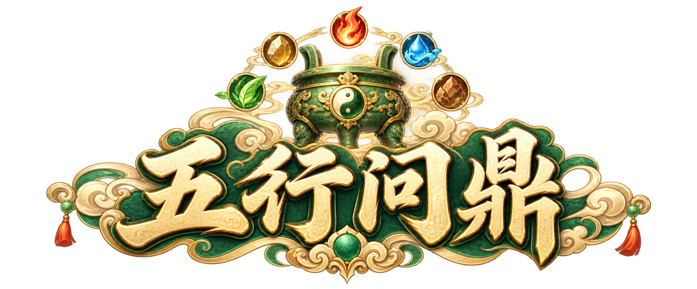

# 五行问鼎 · 美术制作

横版 SLG，道家 Q 版高清手绘。**金、木、水、火、土是五种兵种；武将保留历史身份，其他系统参考率土之滨。** 游戏名采用《五行问鼎》，宣传语候选“布五行之阵，争天下之鼎。”目录和仓库名保留 wuxing-slg-iamge 的原拼写。

完整游戏美术仍在制作。地图按用户要求缩为率土大地图约1/4面积，当前制作尺寸为750×750格、56.25万格，见[地图合同](docs/QUARTER_WORLD_SCOPE_20261030.md)。当前可打开[统一美术检查页](exports/01-率土之滨/art-review-20261029/index.html)，查看人物、五规格资源与兵种逐帧播放。整屏方向图、资源数量或单独包导入通过，均不能代替完整客户端及全状态验收。当前交付见[本轮机器清单](records/current-art-catalog-20261029.json)，最新要求见 [当前制作合同](docs/CURRENT_REQUIREMENTS_20261028.md)。

## 当前采用

| 内容 | 已保存内容与边界 |
|---|---|
| 兵种 | 金木水火土 5 张普通兵母版，20 张静态导出；不是五系英雄。仅当前视角，直接帧图：五兵各20帧、共100帧技术候选；仅SE，100帧/20Clip已实际导入Unity并通过时序采样，行走未通过 |
| 武将 | 刘备、曹操、孙权、赵云、诸葛亮、关羽、张飞、周瑜、吕布、貂蝉、华佗、黄月英 12 名既有身份候选加40名新增，共52名、260张UI导出；按用户确认继续扩展完整率土名册与三国人物；当前52名不是完工分母 |
| 功能界面 | 36 类均有选中静态方向图：本轮 16 张新候选，第13页恢复现存原版，其余19页已逐张审查；仍有视觉映射与局部问题待跟进；[当前36页选稿及待办](records/ui-correction-20261028/current-ui-selection-20261028.json)为本轮记录 |
| 通用 UI | 36 张基础切片，另 16 类补充控件的原生/128 尺寸共 32 张；新增23张通用状态切片和已点检浏览器预览；完整客户端状态仍待校准 |
| 地图 | 33 张地形/建筑候选，另桥梁前后遮挡层及一张连续草地板；草地无缝平铺测试失败，不作为无缝 tile；新增连续河岸桥头底板已通过静态组合复核；新增区域场景布局草案；750×750世界拓扑、导航、外围道路和无缝tile未通过 |
| 特效 | 8 类效果共 64 帧 / 8 AnimationClip；已有独立 Unity 播放证据，不等于兵种动作 |
| Unity 工程 | [独立客户端仓库](https://github.com/luhailong-cpp/wuxing-slg-unity)，本地 D:/work/wuxing-slg-unity；7包基线加326新PNG实际导入，共579 PNG、28 Clip、7 Prefab，ArtGallery与兵种帧检查场景均已保存 |
| 最终验证 | 基线及新批资源像素、库存和Clip采样通过，8张五兵四动作GPU图已查看；正式战斗、行走、多方向与完整客户端仍未通过 |

旧五系英雄、步弓骑及其派生包保留为历史记录，退出默认采用。2026-10-27 的清单与交接属于各自历史截点，不能覆盖本轮要求。新工程没有导入这两套过时方案。

[当前状态矩阵](records/production-20261028/ui-state-matrix.json)记录 36 类页面的 224 个待验证状态，并列出其他缺失流程。它是制作清单，不是完成证明。剩余工作还包括完整内容范围、真实动作、多方向需求、地图连续性、正式中文字体、设备适配及真实客户端视觉验收。

标题标志候选：[原生透明PNG](designs/01-率土之滨/assets/branding/wuxing-wending-title-v1.png)；已实际查看浅深背景，尚未接入Unity。另有[横屏登录背景候选](designs/01-率土之滨/assets/login-background-20261028/login-landscape-v1.png)，与标题分层保存。

## 视觉与来源

两张风格主参考为[邮件界面](designs/mail-ui-v1/01-mail-event.png)与[组队界面](designs/team-ui-v2/team-ui-v2.png)：玉青、米白绢纸、暖金细线、云纹如意与大头短身。率土截图提供功能、布局与武将身份依据。生图前须实际查看并携带主参考。

生成图旁的 .generation.json 关联提示词、实际输入、工具回执、尺寸与 SHA256。派生图另外记录裁切缩放链。模型配置目标为 gpt-image-2.5-sunburst / max；宿主 image_gen 没有该型号/质量选择器时，实际返回未披露字段保持 null，不声称锁定成功。详见[模型政策](docs/IMAGE_MODEL_POLICY.md)。

## 目录与接续

| 内容 | 位置 |
|---|---|
| 整屏 UI | [designs/01-率土之滨/ui](designs/01-率土之滨/ui/) |
| 历史武将母稿 | [designs/01-率土之滨/characters](designs/01-率土之滨/characters/) |
| 五兵种母版 | [designs/01-率土之滨/assets/five-element-troops](designs/01-率土之滨/assets/five-element-troops/) |
| 导出与 Unity 包 | [exports/01-率土之滨](exports/01-率土之滨/) |
| 提示词、回执与验证 | [prompts](prompts/) · [records](records/) |
| 本轮交接 | [CONTINUE_HERE_20261030](docs/CONTINUE_HERE_20261030.md) |

实际美术根目录 D:/work/wuxing-slg-iamge。先读 [AGENTS.md](AGENTS.md)、[视觉规范](docs/UI_STYLE_GUIDE.md)和最新交接。GitHub 为 [luhailong-cpp/wuxing-slg-iamge](https://github.com/luhailong-cpp/wuxing-slg-iamge)，发布按既有单个无父提交快照约定执行；本地新增内容不等于已推送，每次发布需单独核对远端commit/tree。

用户提供的第三方截图保留参考来源；本库没有额外授予第三方内容使用权，也没有统一附加开源许可证。
