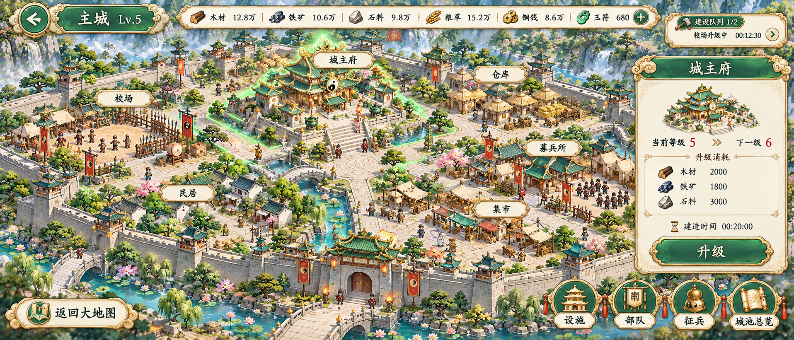
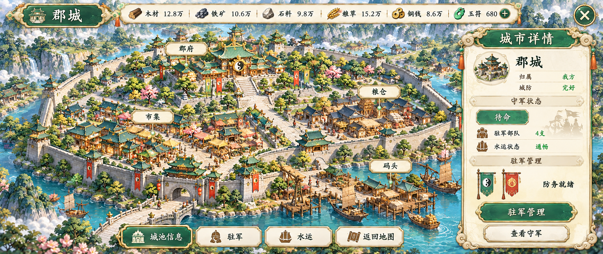

# 主城与城池类型 · 九张独立方向稿

2026-10-26。用户已明确选择「按城池类型继续」。本轮分别生成主城、分城、戍城、要塞、军营、县城、郡城、州府、国都九张完整静态界面，每张都有独立提示词和生成记录。

统一沿用原 image 已确认道家 Q 版高清手绘：玉绿、象牙米白、暖金、圆润云纹和明亮日景。保留工具返回的原生 PNG，没有缩放或拼图代替新图。每图已实际查看，仍待用户确认美术方向。

| 类型 | 用途与场景差异 | 实际原生尺寸 | 来源记录 |
|---|---|---|---|
| [主城](ui/04-main-city-ui-v1.png) | 城主府、校场、募兵所、仓库、民居、集市；选中建筑与升级面板 | 1916×821 | [记录](ui/04-main-city-ui-v1.png.generation.json) |
| [分城](ui/05-branch-city-ui-v1.png) | 经济建设、仓储商贸、水车码头与民居作坊 | 1931×814 | [记录](ui/05-branch-city-ui-v1.png.generation.json) |
| [戍城](ui/06-garrison-city-ui-v1.png) | 军事城池、练兵院、城墙与驻军 | 1916×821 | [记录](ui/06-garrison-city-ui-v1.png.generation.json) |
| [要塞](ui/07-fortress-ui-v1.png) | 小型边地石堡、岗楼与少量营舍 | 1916×821 | [记录](ui/07-fortress-ui-v1.png.generation.json) |
| [军营](ui/08-military-camp-ui-v1.png) | 野外帐篷、木栅、练兵和补给 | 1916×821 | [记录](ui/08-military-camp-ui-v1.png.generation.json) |
| [县城](ui/09-county-city-ui-v1.png) | 小城墙、县衙、农田与粮仓 | 1932×814 | [记录](ui/09-county-city-ui-v1.png.generation.json) |
| [郡城](ui/10-commandery-city-ui-v1.png) | 中型郡府、商贸街区与水运码头 | 1931×814 | [记录](ui/10-commandery-city-ui-v1.png.generation.json) |
| [州府](ui/11-provincial-capital-ui-v1.png) | 区域行政中心、内外街区与府衙高台 | 1916×821 | [记录](ui/11-provincial-capital-ui-v1.png.generation.json) |
| [国都](ui/12-capital-city-ui-v1.png) | 国都行政身份、多进宫府与宽阔中轴街道 | 1916×821 | [记录](ui/12-capital-city-ui-v1.png.generation.json) |

## 主城



## 分城


## 戍城


## 要塞


## 军营


## 县城


## 郡城



## 州府


## 国都


## 本轮制作与检查

场景采用 `baked_scene_mode`，等距俯视；视口目标为约21:9横屏，实际原生尺寸按上表保留。城市画面与HUD目前烘焙在同一张位图中。场景沿道路、院门、桥和行政建筑组织，主要城建区保持可辨。世界尺寸、碰撞、导航、建筑点击区域及客户端动态规则没有在本轮定义；旧 image 的65536主城分块合同不适用于这批新SLG界面。

已检查中文、建筑用途、面板完整性、资源与驻军状态，并视觉核对道路与桥的连接。正式实现仍需数据驱动进度、建设队列、资源消耗、容量和按钮条件；方向稿中的数值都是演示数据。

要塞当前为关闭城门状态，内外道路抵达门洞；如正式场景需要连续通行或开门动画，应补相应状态。场景装饰密度、建筑标签点击范围和军营主帐金饰，可在用户确认方向后按目标终端细化，尚未作为客户端验收结果。

检查记录：
- [军事城池三张](../../records/01-率土之滨/city-military-review.json)
- [经济与城池三张](../../records/01-率土之滨/city-economy-review.json)
- [主城、州府、国都独立复核](../../records/01-率土之滨/city-root-independent-review.json)
- [本批清单](../../records/01-率土之滨/city-batch-manifest.json)

## 功能术语与来源

已实际打开的官方说明支持主城、分城、要塞、军营等入口与城主府、校场、募兵所、民居、仓库、集市等设施用词：[界面操作](https://stzb.gamedreamer.com.tw/NewsContent/zh_TW/stzb2_event_3156.html)、[设施建设](https://stzb.gamedreamer.com.tw/NewsContent/zh_TW/stzb2_event_3186.html)。

分城侧重经济、戍城侧重军事的区分来自[分城改版与戍城说明](https://stzb.gamedreamer.com.tw/NewsContent/zh_TW/stzb2_news_5266.html)。县城、郡城、州府和国都有官方用词依据：[县城说明](https://stzb.gamedreamer.com.tw/NewsContent/zh_TW/stzb2_news_5756.html)、[国家系统](https://stzb.gamedreamer.com.tw/NewsContent/zh_TW/stzb2_news_3966.html)。

县城到州府的外观梯度、各张布局、数值和控件组合是本次设计归纳，未作为现行版本固定等级表。国都是可由占领的郡城或州府选定的行政身份，本图用一座大型城池示意这一身份，没有给它强加独立固定等级。

## 生图与来源追溯

本批使用内置 image_gen（`art_source: host_image`），以项目GPT Image 2.5／max配置为目标。工具没有model/quality选择器，也未返回实际版本与画质，逐图均明确记为未确认。完整[提示词](../../prompts/01-率土之滨/)与[请求／返回记录](../../records/01-率土之滨/)已保存，图旁记录包含配置快照、参考图用途、时间、原生尺寸和SHA256。

每次实际附上邮件、组队、大地图，以及现存旧主城图四张输入；前两张是首要风格依据，旧城仅承接建筑材质。旧索引中缺失的tianyong概览/detail没有恢复。

能力检测使用专用Forge运行器，内置图像入口可用；[检测记录](../../records/01-率土之滨/city-scene-doctor.json)的唯一WARN保留如下，实际已通过显式运行器路径避开默认解释器差异：

```text
[WARN   ] python.path                    other python.exe on PATH: ~/AppData/Local/Programs/Python/Python313/python.exe; ~/AppData/Local/Microsoft/WindowsApps/python.exe
           -> PowerShell, cmd and Git Bash may resolve different interpreters; run Forge with the one shown in python.version
```

