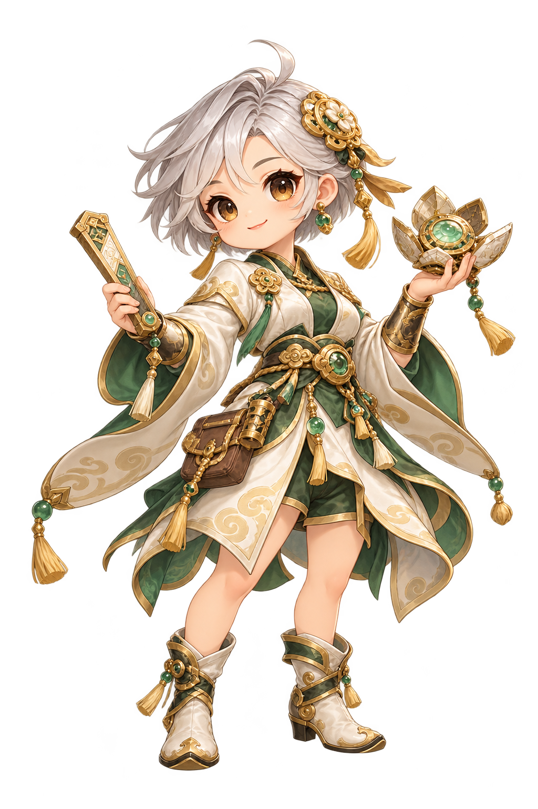
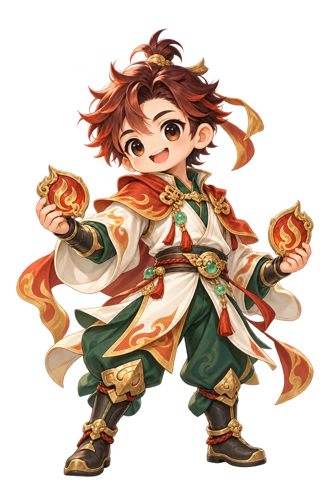
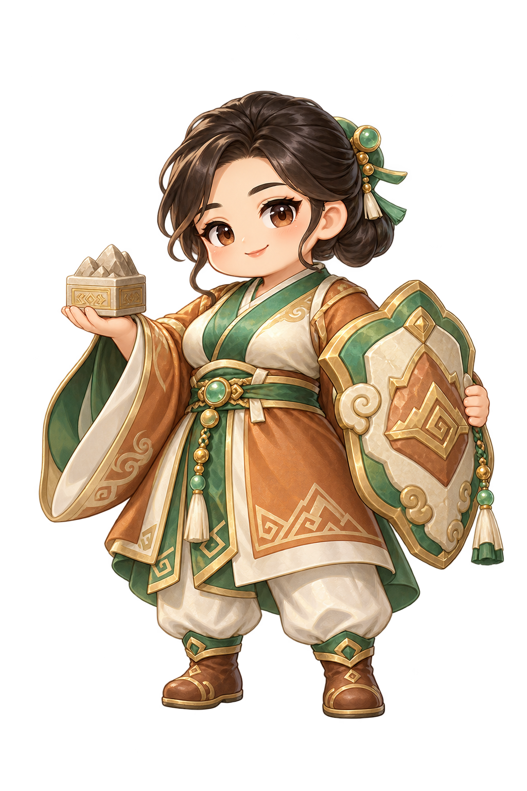
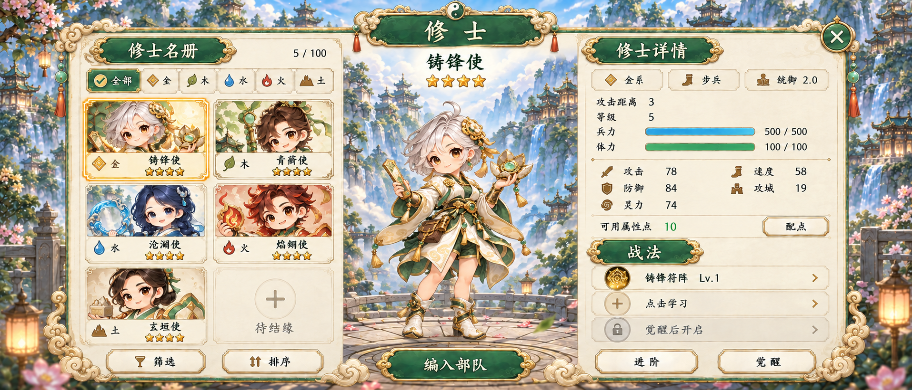
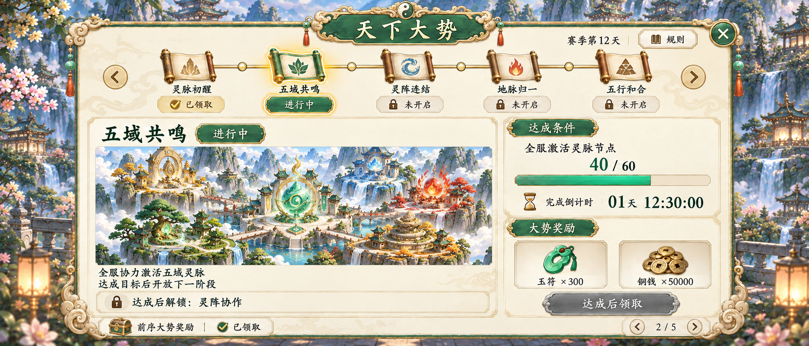

# 五行原创接续制作 · 2026-10-27

> 本页保留第一批截点。当前Unity导入采用[基础V2](../../exports/01-率土之滨/unity/WuxingSLGArtPreviewV2-20261027.unitypackage)与[FX动画扩展](../../exports/01-率土之滨/unity/WuxingSLGFXAnimationPreview-20261027.unitypackage)，UI切片修订、64真实FX帧及行军v4见[第二批](PHASE2_FX_UI_ROUTE_20261027.md)。以下初版111包为历史技术验证，7项切片边缘问题已在V2修复。

本批继续金、木、水、火、土主题，使用邮件、组队两张实际主参考。所有新图通过宿主内置 `image_gen` 生成；每次真实附图并保存提示词、请求、返回和原生PNG。工具未披露实际型号/质量，配置目标仍不能当作实际锁定证据。

全部为候选或方向稿，尚未获用户验收。称号、技能、星级、容量、数值是视觉演示；不构成正式角色名单或玩法合同。动画与客户端未完成。

## 五系原创母版

| 金 · 铸锋使 | 木 · 青蘅使 | 水 · 沧澜使 | 火 · 焰翎使 | 土 · 玄垣使 |
|---|---|---|---|---|
|  |  |  |  |  |

五张均原生1024×1536 RGBA。脸型、发型、衣服结构与法器重新设计，未以三国角色作身份参考。金用银灰短发、符尺与阵盘；木用叶簪、竹杖与种子囊；水用蓝双辫、水环与葫芦；火用赤发、火纹符牌；土用低发髻、山钮印与护阵盾。

主体轮廓完整，浅/深背景均已检查。透明余边未达到提示目标，保留alpha=1微量散点；主体最大alpha为254，未强制归一或程序去背。这些是静态身份母版，尚未完成动画注册、图集或运行时验收。

来源及QA：[金木](../../records/01-率土之滨/five-elements/metal-wood-master-review-20261027.json)、[水火土](../../records/01-率土之滨/five-elements-water-fire-earth-review-20261027.json)。每张PNG旁有独立生成记录。

## 当前 UI 方向

| 页面 | 本批文件 | 处理 |
|---|---|---|
| 天下大势 | [02 v2](ui/02-world-trends-ui-v2.png) | 五域灵脉新场景、新阶段；尚未解锁用锁和“达成后解锁” |
| 修士总览 | [03 v3](ui/03-five-elements-roster-ui-v3.png) | 五系新卡面与金系详情；v3修复中间角色被按钮挡鞋的问题 |
| 金系详情 | [18 v2](ui/18-metal-envoy-detail-ui-v2.png) | 使用铸锋使母版，真正替换旧历史身份 |
| 招募结果 | [19 v2](ui/19-metal-envoy-recruit-result-ui-v2.png) | 五行金系原创身份，初始获得状态 |
| 金系配点 | [23 v2](ui/23-metal-envoy-attributes-ui-v2.png) | 同一人物与属性预览 |
| 金系兵种 | [24 v2](ui/24-metal-envoy-troop-types-ui-v2.png) | 同一人物与兵种功能 |
| 建设管理 | [36 v2](ui/36-construction-queue-ui-v2.png) | 石料浅色石块、铁矿深蓝灰矿石，顶部及升级行统一 |

主角在这些整屏中是模型参考再现，不能称为程序像素级复用或最终动态UI。03v2保留为真实AI编辑输入，03当前选v3；36v2与03v3原生1915×821，其余以各自记录为准，不作固定客户端尺寸承诺。

## 独立导出

| 资源 | 实有文件 | 清单 |
|---|---|---|
| 五行徽记 | 5张原生裁切＋15张32/64/128px派生 | [emblems-manifest](../../exports/01-率土之滨/five-elements/emblems/emblems-manifest.json) |
| 城池/建筑/地形 | 33张原生裁切候选 | [map-kit-manifest](../../exports/01-率土之滨/map-kit/map-kit-manifest.json) |
| 静态FX | 8张原生裁切候选，动画帧0 | [fx-manifest](../../exports/01-率土之滨/fx/fx-manifest.json) |
| 步兵/弓兵/骑兵 | 3张1254方RGBA原生master，另3张原生裁切＋6张64/128高派生 | [units-manifest](../../exports/01-率土之滨/units/units-manifest.json) |

地图与FX保留原生像素，不重画、不去背、不缩放。41件均无alpha>1的主体触边，仍有41项 `NATIVE_ALPHA1_GUTTER_RETAINED` 警告与7项 `NARROW_NATIVE_GUTTER` 警告（最小余边依次10/9/13/9/8/8/10px，偏好16px，最低检查线8px）。逐件值、阈值与文件列在各manifest及[完整复核](../../records/01-率土之滨/mapfx-native-crop-review-20261027.json)。锚点暂按主体底中，未验证无缝、碰撞、导航或目标引擎。

徽记原网格在 `--expect 5` 下无FAIL，保留 `boundary_band=65`（阈值0）、`safe_frame=5`（阈值0）与 `faint_specks.floor_px=27805` / `detached_components=0`（阈值0）警告。手工ownership框完整覆盖所有alpha>1内容且不穿边；没有抹去原生低值alpha。32px下可区分五种剪影，64/128px下细节更清楚；仍待用户及客户端确认。

## 真实未完

完整五行适配未覆盖其余所有功能屏；正式角色名单、技能与材料体系尚未确定。步/弓/骑静态master现已补齐，但其他朝向、动作动画和五系单位/建筑变体仍待做；完整控件状态、动态文字拆分和客户端接入也未完成。历史人物候选明确排除正式首发，不能按本批新增数量宣称全游戏完工。

用户已选择Unity导入包。[111 Sprite候选预览包](../../exports/01-率土之滨/unity/WuxingSLGArtPreview-20261027.unitypackage)已在实际Unity6000.6.0f1完成源导入、导出与独立空工程回导；PNG字节、原生尺寸、alpha计数、Sprite及锚点均核验。包为28,754,662字节，SHA256为 `c7d20bb4a089da76dea0f412e7cb07e36fe77888b76ac222e265186396df411c`。原生RGBA32不压缩，NPOT不缩放，无mipmap，PPU100及锚点为预览约定；readable=true供验证，手机内存/渲染性能尚未验收。

保留Unity两类CS0618弃用警告（ImportPackage/ExportPackage），编译错误0；首次回导因异步导入未结束而提前验证失败，改为importPackageCompleted回调后第二次成功。详见[真实Unity验证汇总](../../records/01-率土之滨/unity-preview-package-verification-20261027.json)。包只含候选Sprite、文本清单及meta，不含历史角色、整屏或运行时代码。可回导不表示客户端接入或整套美术验收。

最新机器清单见 [current-art-catalog](../../records/current-art-catalog-20261027.json)，只在完整文件与来源核验后生成。
