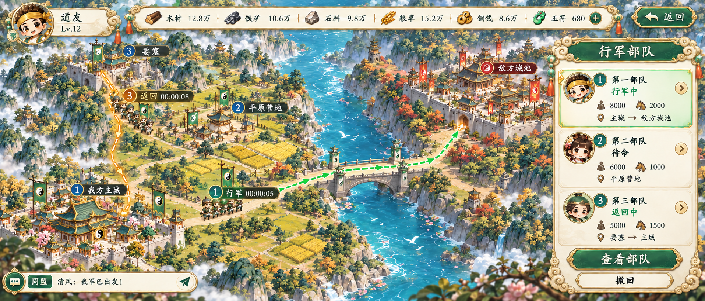

# 第二批接续：特效帧、行军路线与独立UI修订

本批继续五行主题与道家Q版玉绿、米白、暖金画风。生成入口仍为宿主内置image_gen，实际型号和画质未披露，未将配置目标冒充实际返回。

## 八类真实特效帧

已生成、逐格审阅并登记8类、共64张不同PNG相位帧。每类8帧、每帧0.1秒、总长0.8秒、单次播放。它们是生成式相位动画候选，具有起势、增长、峰值和消散，并非把旧静态FX当动画。每帧源图、裁切框、原生像素、共享作用中心与整数平移/透明补边均有记录，没有逐帧按bbox缩放或程序重画。

| 特效 | 当前清单 | 源QC safe_frame | faint_specks floor_px / detached_components |
|---|---|---:|---:|
| 斩击弧 | [slash-arc](../../exports/01-率土之滨/fx-animation/slash-arc/manifest.json) | 3 | 127930 / 4 |
| 符阵 | [strategy-array](../../exports/01-率土之滨/fx-animation/strategy-array/manifest.json) | 3 | 96502 / 2 |
| 治疗光 | [healing-light](../../exports/01-率土之滨/fx-animation/healing-light/manifest.json) | 3 | 146546 / 27 |
| 增益云气 | [buff-cloud](../../exports/01-率土之滨/fx-animation/buff-cloud/manifest.json) | 0 | 92932 / 2 |
| 减益紫雾 | [debuff-mist](../../exports/01-率土之滨/fx-animation/debuff-mist/manifest.json) | 3 | 180779 / 67 |
| 火焰 | [fire](../../exports/01-率土之滨/fx-animation/fire/manifest.json) | 4 | 95863 / 3 |
| 占领光圈 | [capture-circle](../../exports/01-率土之滨/fx-animation/capture-circle/manifest.json) | 7 | 369927 / 22 |
| 奖励光芒 | [reward-glow](../../exports/01-率土之滨/fx-animation/reward-glow/manifest.json) | 2 | 264111 / 100 |

表中三项原始QC阈值均为0，非零项仍为WARN。原alpha低值散点保留，没有清除后冒称通过。治疗光的名义网格曾有cross_cell_visible=1，已用实际无可见交叉的人工ownership边界裁切，原FAIL证据保留；增益v1跨格、斩击v1等拒绝版本也保留真实失败记录。手工作用中心注册解决了源表行间漂移，剩余亚像素/轮廓变化与运动质感仍待审阅。

主窗口实际查看64相位的深青/米白合成，八类alpha总量均0→4增长、4→7衰退，文件哈希吻合。详见[主窗口相位复核](../../records/01-率土之滨/fx-animation-root-phase-review-20261027.json)，逐类manifest含全部原始WARN/FAIL及文件、阈值、人工处理范围。

这是技术预览时序，没有攻击/治疗/伤害判定事件。末帧按生成合同保留微光；不循环不等于自动清空Renderer或销毁对象，调用方需要在播放结束后隐藏或回收。角色、单位动作动画仍未完成。

## 行军图 v4

重设计为两岸、一条河、一座桥：绿线沿陆路完整跨桥顶面后通往敌城；金线由要塞返回主城入口，待命部队无起始路线。v2仍有水面接桥和双向箭头，未选用；v3绿线正确，但金线越过主城延伸，随后以v3为真实输入修成v4。没有把失败修图记为通过。

新图沿用[几何参考计划](../../records/01-率土之滨/reference-contact/march-layout-v3.scene-plan.json)的连通拓扑，实际绘画位置未逐像素符合guide，不能把guide坐标直接当成碰撞或导航数据。仅通过静态路线视觉复核，未验证游戏寻路。详见[行军复核](../../records/01-率土之滨/continuation-ui-21-route-review-20261027.json)。

## 独立UI修订 v2

[36项新版切片清单](../../exports/01-率土之滨/runtime-ui-v2/runtime-ui-manifest.json)修正了旧裁切的问题：两种hover光晕触边/混入上行尾，攻击、防御、策略、攻城、沙漏图标混入邻格。16个控件态统一500×204画布并登记同一美术框中心；5枚图标重新按实际透明间隔裁切；其余15项原样复制。共21项重切与登记、15项字节复制，没有重新生图、缩放或抹alpha。

全部36项输出边缘alpha>16为0，并核对21项源裁切像素一致。仍保留36项alpha1残留WARN与13项窄边距WARN；五枚修订图标最小余边分别3/6/2/4/2px，不能称宽阔余边合同通过。九宫格边界仍是候选，实际空工程渲染和用户客户端状态分别记录。详见[新版切片检查](../../records/01-率土之滨/runtime-ui-v2-crop-review-20261027.json)。

真实Unity6000.6.0f1在Direct3D11/RTX3070Ti完成48张GPU渲染。四组控件固定204高，从500拉宽至900时四角128×90像素差为0；纵向500×300会拉长12态侧玉珠/卷纹，另4态纸纹纵向效果也未接受。**四组控件仅作固定204高的横向候选，纵向拉伸不支持。** 角像素差为0没有被扩大成整体九宫格或客户端验收通过。主窗口另实际查看了group1浅底、group3深底及图标浅底。

## 当前Unity导入组合

| 包 | 实物与来源 | 实际核验 |
|---|---|---|
| 基础V2 | [WuxingSLGArtPreviewV2](../../exports/01-率土之滨/unity/WuxingSLGArtPreviewV2-20261027.unitypackage)，30,714,578字节，SHA256 `b0d8ce3ddd8d6077db01353a611853f6b6e2545264cd0a27b24f9d1d5ac27ed5` | 111Sprite源导入、导出与独立空工程回导；使用新版36UI，其余75Sprite来源不变 |
| FX扩展 | [WuxingSLGFXAnimationPreview](../../exports/01-率土之滨/unity/WuxingSLGFXAnimationPreview-20261027.unitypackage)，7,827,361字节，SHA256 `18919229cf380d5cbd16cc6fa76fcb5197f94315d62af06d6b8c6ae54ea9e018` | 64Sprite、8Clip、64个唯一时间key(0..0.7)，实测长度0.8000000119秒；无额外重复key、无循环/事件 |

两包均实际导出及空工程回导通过，PNG字节、meta、Sprite引用与时长核对。Unity首次FX时长0.9秒、一次中间目录创建失败均保留，已按实际API采样语义及AssetDatabase.CreateFolder修复；没有把失败轮次改成通过。当前175Sprite/8Clip的组合仍是候选导入集，不是客户端或最终美术验收。

证据：[V2最终验证](../../records/01-率土之滨/runtime-ui-v2-unity-final-review-20261027.json)、[V2使用限制](../../exports/01-率土之滨/unity/WuxingSLGArtPreviewV2-20261027.usage.md)、[FX真实Unity验证](../../records/01-率土之滨/unity-fx-animation-package-verification-20261027.json)。GPU控件渲染不等于已渲染FX连续播放，后者仍记录为相位候选/技术回导通过。

## 仍未完

所有输出仍为待审候选。完整五行玩法/技能材料、正式首发名单、全部UI动态层、角色与单位动作、额外方向、真实游戏导航与客户端、设备内存/性能仍未完成。Unity包的可导入与Clip引用/时长验证不能代替这些验收。

角色/单位视频生成当前无宿主入口、视频API或已安装Grok CLI；专用Forge环境的解码/透明视频处理则已实际通过。此能力阻塞只涉及新人物动作源片，不把FX64帧算作人物动作。8母版的真实hash、24条动作提案及可继续条件见[角色/单位动作接续](../../docs/CHARACTER_UNIT_ANIMATION_NEXT.md)。
