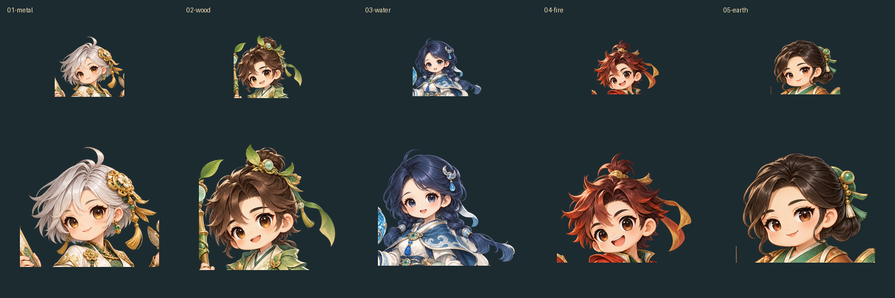
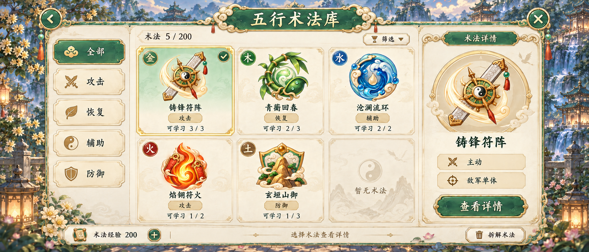
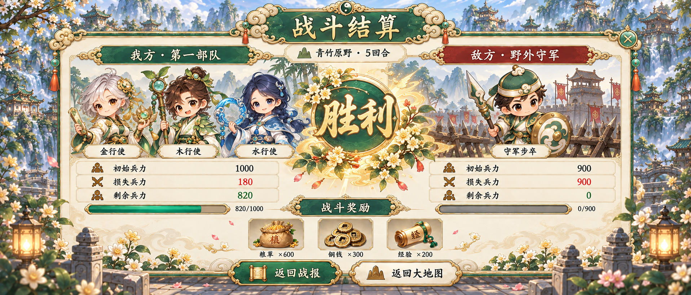
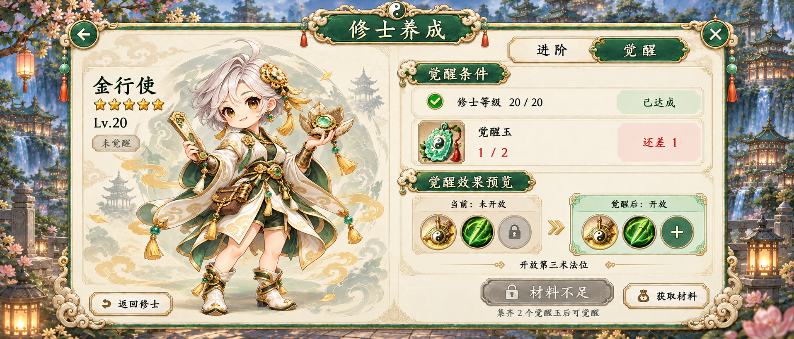
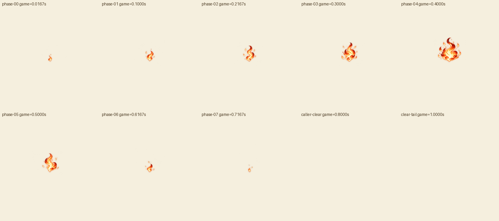
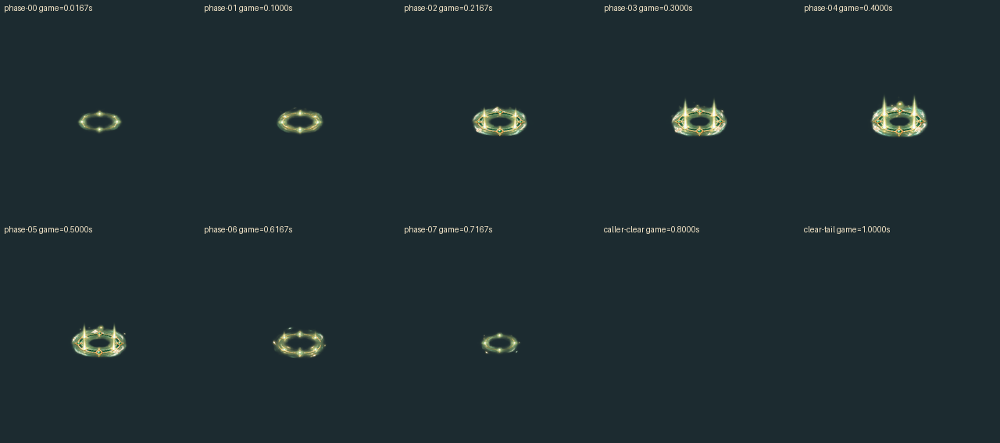
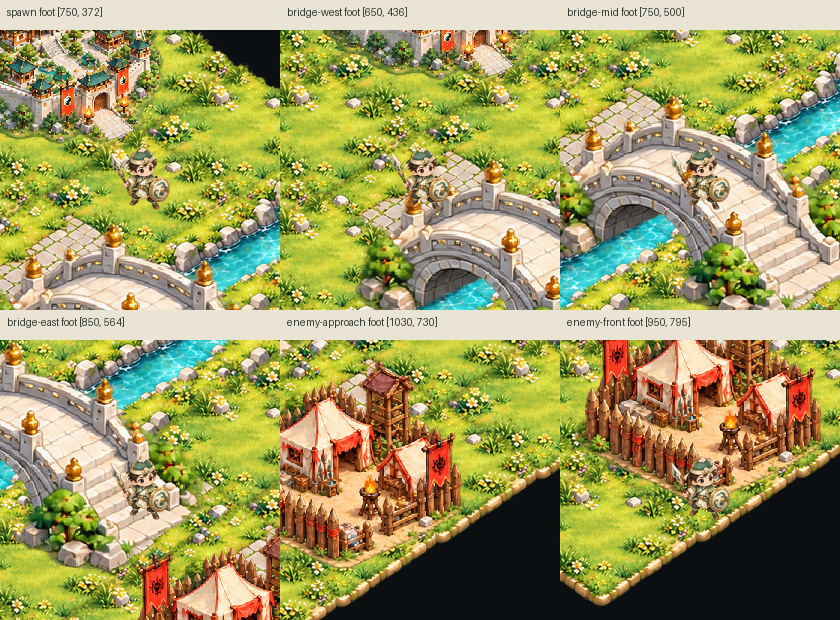
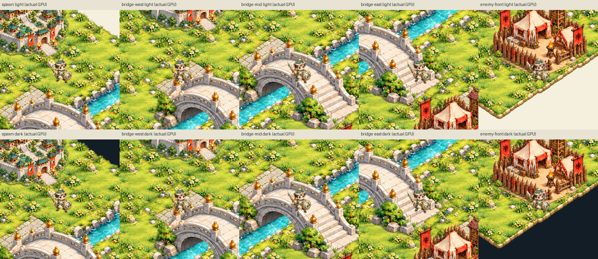

# 第三批：Unity角色技能、五行流程与地图/FX验证
 
本批仍是制作候选，完整游戏美术未完工。用户已选择Unity导入，当前约定见[Unity交付约定](../../docs/UNITY_DELIVERY_CONTRACT.md)。所有数量是实际文件或实际检查次数，不是正式验收覆盖率。

## 当前新增

- 五位原创母版派生25张角色UI图：每位原生face/bust、128/256头像、768×1152整身卡面。来自同一母版像素，未AI重画；原生crop、premultiplied-alpha缩小与透明padding逐项记录。
- 五行技能母图通过宿主内置image_gen实际生成，5native裁切＋15张32/64/128派生。技能与已有元素徽记不同；名称与规则仍候选。
- 13—17术法、编队、征兵、战报，以及33—35结算、觉醒、招募新增五行方向。具体当前版本由[机器清单](../../records/current-art-catalog-20261027.json)选择；这只是制作选择，全部userApproved=false。
- 既有地图资源拼装成35地块、城池—单桥—敌营候选；6条路线在实际Chrome验证可达。碰撞与道路是独立的provisional数据，画面接缝和桥遮挡仍待修。
- 既有8FX在Unity真实PlayMode/D3D11录制，观察00→07，固定锚点/缩放，0.8秒调用方清除得到空背景；不改源图，不将60Hz录制计作60个绘制相位。

## 角色与技能包

[下载45 Sprite角色技能Unity包](../../exports/01-率土之滨/hero-ui-v1/unity/WuxingSLGHeroSkillUIPreview-20261027.unitypackage)，17,871,029字节，SHA256：
`86b9f91cee815fbc419d9cf537c0fcfcf1109ca9f48ce601acfe1cdd67693e65`。

真实Unity6000.6.0f1源导出与独立空工程回导均45通过；PNG字节、尺寸、alpha计数、pivot/border及来源记录hash一致。与基础V2/FX/旧基础包的路径及GUID交集均0。[最终回导验证](../../records/01-率土之滨/hero-skill-ui-final-review-20261027.json)、[来源索引](../../exports/01-率土之滨/hero-ui-v1/unity/hero-skill-ui-source-index-20261027.json)。

矩形肖像会有意截断衣缘，15个face/avatar仍含同一母版法器局部，20个portrait有构图截边；这些不是邻格污染，也没有擦除遮罩。128头像脸部约41—64px宽，水系为保留辫梢而较小。完整人物用整身卡面。softalpha/alpha1、母版余边及未获采用等WARN保留，见[英雄派生复核](../../records/01-率土之滨/hero-ui-v1-derived-review-20261027.json)。

技能原图未达到320px主体/96px余边要求。原始QC保留：`boundary_band=17,threshold=0`、`safe_frame=5,threshold=0`、`faint_specks={floor_px:68154,detached_components:9},threshold=0`。第6空格仍有259个alpha1像素。第一列归属边界由512改496，在alpha≤1空带内分开金/火；全部source alpha>1像素恰覆盖一次、无重复，5native四边alpha>1均0；未清alpha。32仅作小标识，主技能展示建议64或以上。[技能清单和原始QC](../../exports/01-率土之滨/five-elements/skill-icons/skill-icons-manifest.json)。

## 五行整屏候选

13的火/土下缘裁窗经历真实新版本修订，当前v5完整，额外play/演示配置按钮已移除。35v2金系莲盘与水环曾混合，v3已分开水环与其持有手；保留旧源稿与回执。33的1000−180=820、900−900=0与奖励600/300/200核对；34等级20/20、材料1/2缺1与禁用按钮、锁位→空加号对应；35玉符680对费用1000缺320，单次200可用。

当前13—17选择为13v5、14v3、15v3、16v3、17v4，均原生1915×821。14把“品阶待定”改为明确的元素归属金，14—17内部演示说明已从产品界面清除，15—17称呼统一金行使/木行使。样例性质留在来源和复核记录；旧带说明稿及initial-review快照保留为历史。root逐张实际查看了当前5页，统御2.0＋2.5=4.5/8、征兵1000→2000增加1000、粮草10000−8000缺2000，战报100＋80损失180与400＋420剩余820一致；不据此断言它们是同账户连续流程。

31土地/32背包实际复看无具名历史身份；背包3×1000=3000一致，保留为中性候选，规则和全状态仍未验收。25登录保留空游戏名牌与匿名道童/兔，正式标题/NPC采用待定。

所有整屏人物是AI依照母版重绘的烘焙方向，并非把独立头像原像素直接贴入；运行时可复用的source PNG在角色技能包。星级、等级、统御、材料、费用、兵力、技能名字/距离/概率等均为独立样例，不构成同一账户连续流程、正式招募池或玩法合同。文字与数值最终须分离到客户端层。当前1915/1916×821原生尺寸各自保留，未强行拉齐。见[root31—35复核](../../records/01-率土之滨/root-phase3/ui-31-35-root-review-20261027.json)及[13—17复核](../../records/worker-theme-phase3/five-elements-ui-13-17-review-20261027.json)。

## 实际FX GPU录制

[浅底8效果MP4](../../records/fx-gpu-playback-v1/video/all8-light.mp4)、[深底8效果MP4](../../records/fx-gpu-playback-v1/video/all8-dark.mp4)，读序为slash、strategy、healing、buff；debuff、fire、capture、reward。

Unity6000.6.0f1、D3D11 RTX3070Ti，8个实际Animator Clip×浅深背景×60捕获，共960本地GPU PNG。752可见样本都非空且相位按00→07；world0/scale1、投影anchor256固定。0.800000000869秒caller禁用renderer/Animator并clear Sprite，之后208次截帧与空背景逐像素一致。原Clip末帧仍非空，不会自动消失。

Time.captureFramerate=60用于确定性录制；1秒游戏时钟约9.2秒墙钟，非60FPS性能测试。原素材仍8绘制相位，约10FPS，没有补间。保留48条float epsilon诊断，名义键边界最大差约0.228微秒；实际每相位5—7次采样，752样本在1微秒相位容差内，不宣称恰6次。

[可选GPU演示Unity包](../../exports/01-率土之滨/fx-gpu-playback-v1/WuxingSLGFXGpuPlaybackDemo-20261027.unitypackage)仅11,073字节，SHA256 `a211d36227f0bdb1b3c0770f4e06e3cbfc6f0cebbdbf4c5e22213744c97b71aa`。先导入FX64帧原包，再导入示例；独立空工程依赖回导已解析8Clip/8Controller/64Sprite。示例新增路径/GUID与旧包无交集，72外部FX GUID均解析，无未知。示例会输出GPU捕获，不是实际游戏客户端。

公开证据为18个MP4、16张相位/clear montage、50张原生关键GPU图及旁记；960完整raw在本地work未公开，记录已明确本地引用政策。来源、时钟与复核见[GPU最终验证](../../records/fx-gpu-playback-v1/final-review.json)。root实际看了4张GPU montage及source报告，未把它们冒称完整MP4流畅验收；finalSmoothnessApproved=false。

## 地图拼装候选

[下载并打开离线试玩HTML](../../exports/01-率土之滨/map-assembly-v1/playable-preview.html)：WASD/方向键、点击寻路、E仅演示交互。6种现有地图PNG＋1步兵PNG，35地块＋3物件；原PNG未改。单位是固定SE静态滑移，没有行走/方向动画。地图结构验证通过；6/6路线在真实Chrome通过，拿掉唯一桥通行区的负控4目标不可达符合预期。

保留unreachable_walkable_area WARN：2微小孤立口袋共3个4px格。重复花丛/独立石沿接缝、5河块镜像光照、桥未分前栏、屋顶无per-pixel遮挡提示、尺度碰撞与alpha1等仍待修。默认Playwright Chromium缺失的SKIPPED及早期opaque探针SKIPPED/错误汇总false原样保留；实际Chrome独立验证未冒充该跳过项通过。schema修复前和首负控输入原字节缺口明确，不用重建不符hash替代历史。所有当前数据/PNG来源已核对，详见[地图manifest全部WARN原值](../../exports/01-率土之滨/map-assembly-v1/assembly-manifest.json)和[地图复核](../../records/01-率土之滨/map-assembly-v1/review.json)。

最小补图需求为共享边草地、匹配两轴河岸与桥头、两轴/转角道路、桥前栏分层。候选连通检查不证明最终画面碰撞/接缝/正式地图规则或移动端性能。

### 地图Unity扩展

[地图场景Unity包](../../exports/01-率土之滨/map-assembly-v1/unity/WuxingSLGMapAssemblyPreview-20261027.unitypackage)，1,000,922字节，SHA256 `1020e1364bd4cc7c1b89fd0dff3272258bde1b1091e1c02c1e19a1cdfbe7fd92`。独立Assets/WuxingSLGMapAssemblyPreview/，7个源像素复用Sprite、35地块＋3物件＋1单位共39实例、8点固定路线、相机和场景。不是7张新绘艺术。

源真实导出、空工程回导：7PNG字节/alpha/native尺寸/pivot/importer、全部39实例坐标scale/flip/sort/contact、8路线引用与无missing scripts通过。真实PlayMode D3D11 RTX3070Ti运行275个LateUpdate观察，5脚点×浅深10张GPU图，九点脚碰撞/路线/投影/同一SE Sprite/步进预算通过；最大步进2.500041px、名义2.5px、float容差0.02。暂停窗口4观察（触发后3次Update暂停）及组件重启有效。去桥时Unity仅另实测中点无效；6目标/去桥4目标不达沿用canonical报告，未重做Unity A*。无行走动画、combat/physics或动态寻路。

新增WARN：native Sprite GPU bilinear与PIL圆整LANCZOS拼板不同；固定3:2/1440×960采样，空工程默认aspect1.333而projection/GPU显式1.5，任意纵横比与移动端未验；原生Space/R未注入测试，仅实际组件方法暂停/重启验证。6类包外Editor CS0618原文保留，包内runtime未使用这些过时API，编译错误0。首次不存在inputlegacy包条目的依赖FAIL保留，移除后依安装自带DLL通过，未下载新框架。原始日志只留work；公开diagnostics排除许可/会话行。[完整验证和所有WARN](../../records/01-率土之滨/map-assembly-v1/unity/verification.json)、[用法](../../exports/01-率土之滨/map-assembly-v1/unity/USAGE.txt)。

## 仍缺

人物/兵种动作帧仍为0。现有5英雄和3地图单位需要同母版真实动作源片；当前无已配置视频生成路线，本地视频处理链可用。不能以静态滑移、不同母版随机帧或上述FX冒充人物动作。另有完整适用UI状态、正式首发/NPC/技能数值、最终设备、真实Unity工程与客户端验收待确认。见[动作接续](../../docs/CHARACTER_UNIT_ANIMATION_NEXT.md)。

