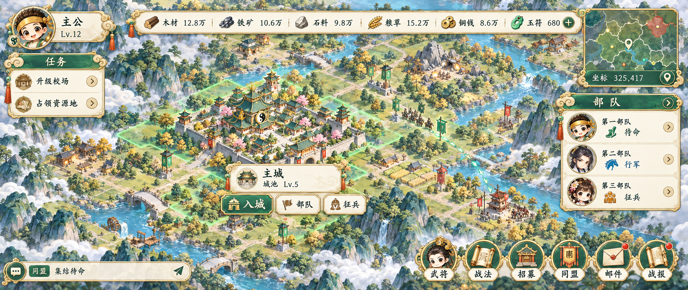
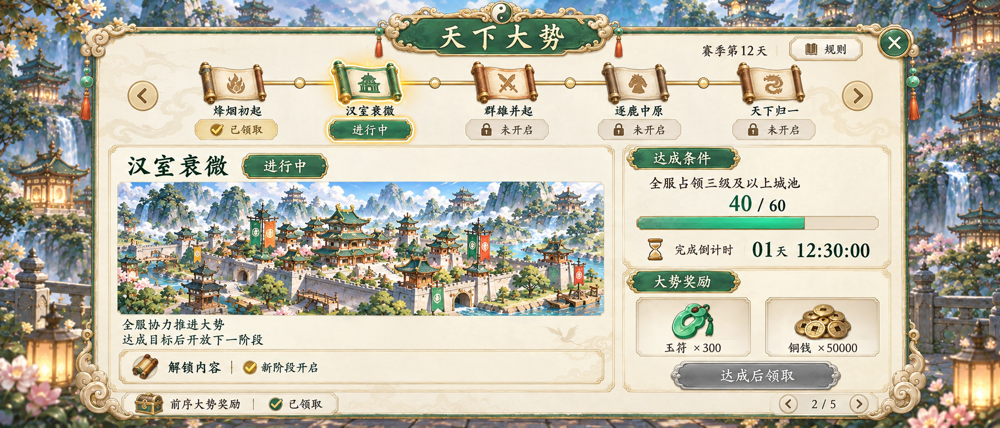
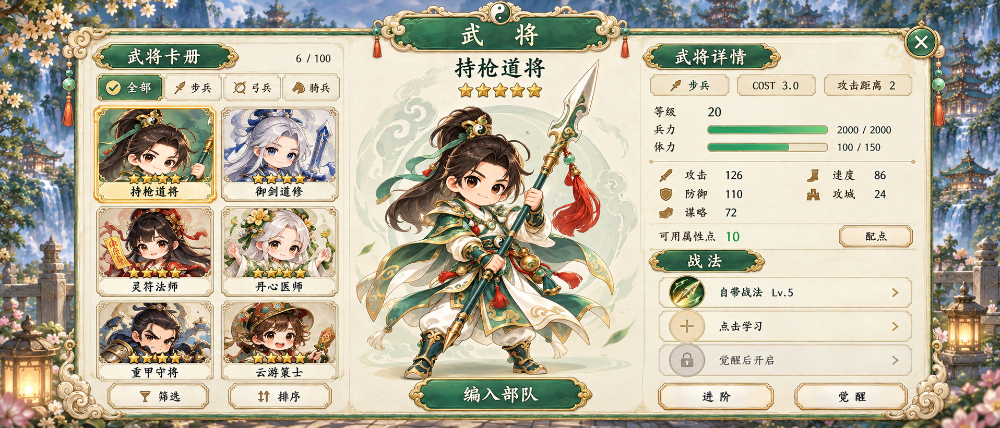

# 率土之滨参考项目 · 道家 Q 版 UI 与角色方向稿

> 2026-10-27 状态更正：游戏主题为金、木、水、火、土，率土之滨仅供功能和布局参考。当前已有 36 个 UI 功能整屏（17 另有 v2），本页以下“十二张 UI 与一张角色”等描述是首轮历史快照。历史身份候选需重新设计，全部整屏仍为静态方向稿，未完成全游戏美术验收或客户端接入。最新入口见[项目 README](../../README.md)与[接续文档](../../docs/CONTINUE_HERE_20261027.md)。

2026-10-26。首两轮制作 SLG 大地图、天下大势、武将三张界面与一张透明持枪道将。随后按用户确认的城池类型，新增主城、分城、戍城、要塞、军营、县城、郡城、州府、国都九张独立方向稿，见[城池整套预览](CITY_BATCH.md)。当前共十二张 UI 与一张透明角色方向稿。正式游戏名与角色姓名仍待指定。

| 图片 | 原生尺寸 | 类型 | 逐图来源记录 | 状态 |
|---|---|---|---|---|
| [大地图主界面](ui/01-world-map-ui-v1.png) | 1931 × 814 | RGB PNG | [生成记录](ui/01-world-map-ui-v1.png.generation.json) | 已视觉检查，待用户确认方向 |
| [持枪道将](characters/01-spear-dao-general-v1.png) | 1024 × 1536 | RGBA PNG，真实透明通道 | [生成记录](characters/01-spear-dao-general-v1.png.generation.json) | 已视觉检查，待用户确认方向 |
| [天下大势](ui/02-world-trends-ui-v1.png) | 1916 × 821 | RGB PNG | [生成记录](ui/02-world-trends-ui-v1.png.generation.json) | 已检查，待确认；解锁提示有细化项 |
| [武将界面](ui/03-generals-ui-v1.png) | 1916 × 821 | RGB PNG | [生成记录](ui/03-generals-ui-v1.png.generation.json) | 已视觉检查，待用户确认方向 |

采用内置 image_gen，以项目 GPT Image 2.5／max 配置为目标；工具未披露实际模型与画质，每图记录均明确保留未确认状态。原生尺寸保持不变，没有放大处理。实际[提示词](../../prompts/01-率土之滨/)与[工具请求／返回记录](../../records/01-率土之滨/)均已保存。

## 大地图主界面

功能与样例数据详见[本轮制作说明](PRODUCTION_BRIEF.md)。这是一张完整静态视觉稿，布局为本次设计；没有客户端交互或正式切片验收。

## 持枪道将

原创道将形象用于确认本项目角色美术方向。透明背景四角 alpha 均为0，存在710971个完全透明像素；主体与边缘由原始生成 alpha 表达，未程序去背。枪尖、披风与双足完整。正式切图时可按合同增加透明边距。

## 天下大势

展示五阶段时间线、当前大势、全服目标、40/60进度、倒计时与奖励。当前未达成，领取按钮为灰态；前序已领取，后续锁定。阶段排列与数据为本轮概念示例，官方术语依据见[补充制作说明](SUPPLEMENT_UI_BRIEF.md)。解锁内容旁的勾号存在歧义，正式版本需改为锁或明确写「达成后解锁」；此项保持未解决状态。

## 武将界面

包含六张武将卡、兵种筛选、持枪道将完整立绘、等级／兵力／体力／COST／攻击距离、五维属性和三格战法，以及配点、进阶、觉醒、编入部队入口。当前为完整静态方向稿，示例属性不构成原版武将数据。

## 检查与待确认项

四张 PNG 文件解码正常，项目副本与各自工具原始输出 SHA256 一致。已实际查看输出并独立复核风格、中文、部件完整性和遮挡；没有阻塞方向稿查看的问题。

后续可调整：地图细节稍密、部队面板占幅较大；角色金甲纹样与高光略繁。天下大势的解锁提示待细化，正式实现的进度条应按数据精确绘制。全部保持待用户确认，尚未作为最终游戏资源或客户端接入结果。详情见[首轮检查](../../records/01-率土之滨/first-drafts-visual-review.json)和[补充界面检查](../../records/01-率土之滨/supplement-ui-visual-review.json)。

