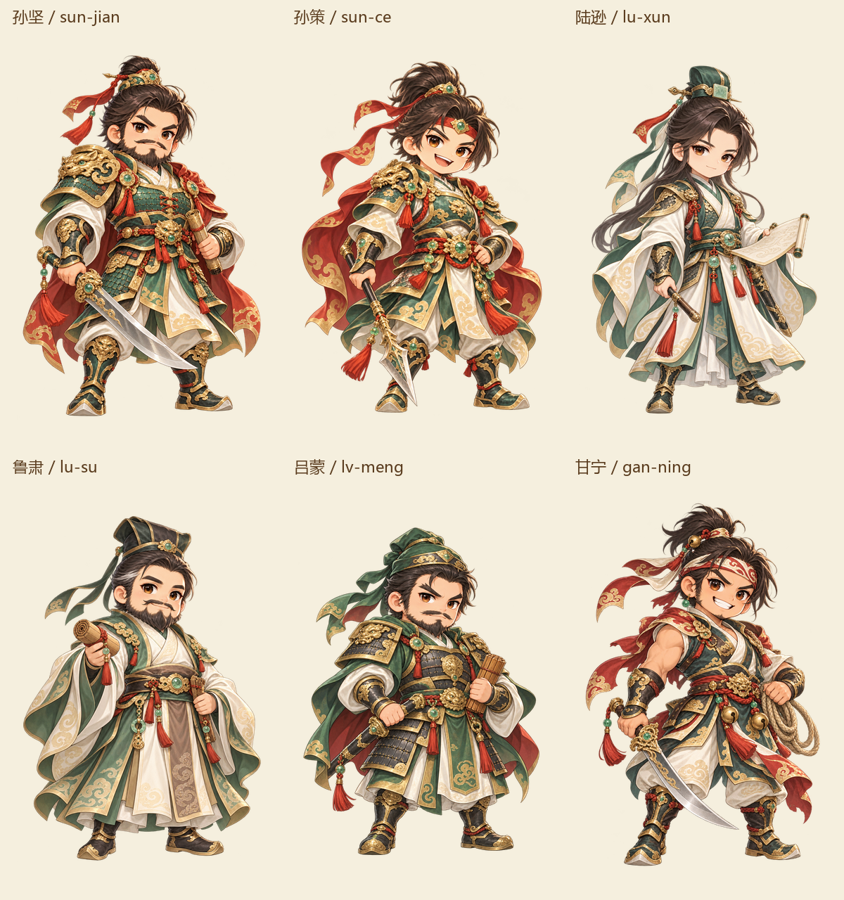
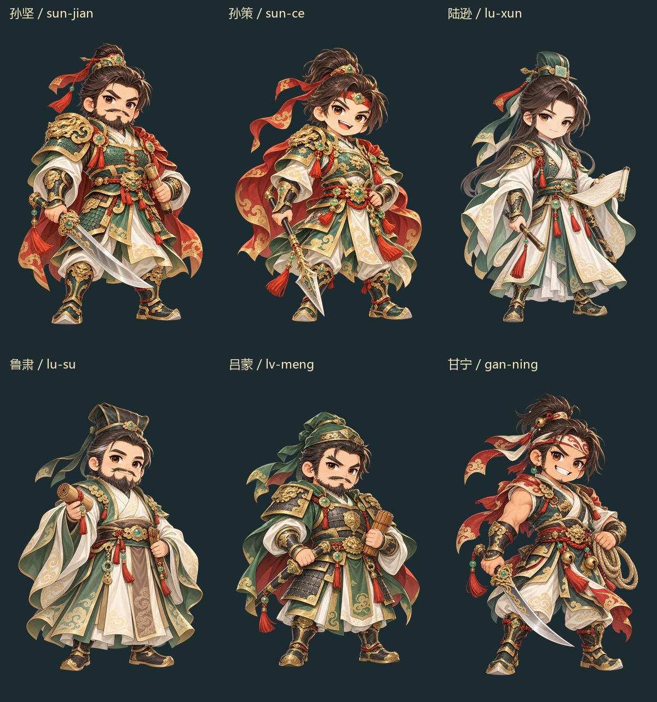
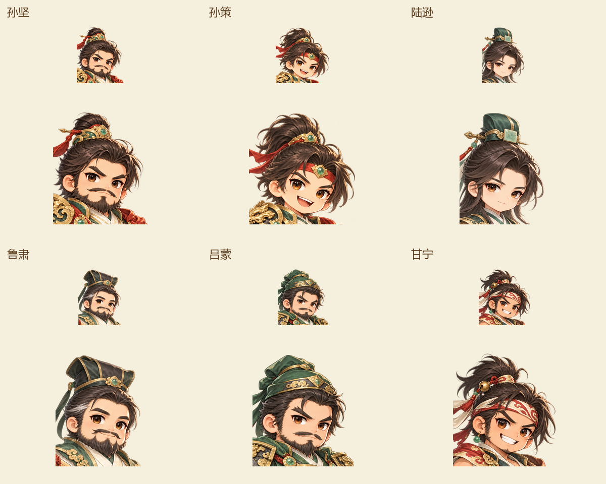

# 吴人物第一批：6 张母稿与 30 个 UI 派生

批次：roster-expansion-20261029-wu1。当前结论：六人均选为静态美术候选，已实际查看 6 张原图及 16 张浅/深背景 QA 图。未认定为用户最终验收、客户端验收或整款游戏全部美术完成。

人物：孙坚、孙策、陆逊、鲁肃、吕蒙、甘宁。武器属于人物造型，不用于步弓骑分类，也未将武将编成五系英雄。

稳定选择：`records/roster-expansion-20261029-wu1/selections.json`。
UI 清单：`exports/01-率土之滨/roster-expansion-20261029-wu1/generals-ui-manifest.json`。
实际视检：`records/roster-expansion-20261029-wu1/visual-qa.json`；像素核对：`records/roster-expansion-20261029-wu1/pixel-validation.json`。

| 人物 | personID | 母稿 SHA-256 |
|---|---|---|
| 孙坚 | ww-p-745064a05078 | afafd07555ff615c7824efb17526c992759bb8cacb36b4fdecefda4e6cb9cc6c |
| 孙策 | ww-p-8fa0077b6be6 | 7cce405788136b7e78c1f1c2700f7f7133f4674d1649ef9dbe647cbeb72cc2c5 |
| 陆逊 | ww-p-91d823d76f0b | bac25ce9f9eda35f22f1eade3cd341aca10d180f19e51c3497cada279a3d3457 |
| 鲁肃 | ww-p-397eac76e115 | 9a190bafe22cddf6ec492fba418db3e341e8868b6687459a7a151f8640e06ae8 |
| 吕蒙 | ww-p-799cddfec017 | 69a69e2c2c8f26331fe18cc39cd1d019c385de6df872e0faf2522371ec67f97b |
| 甘宁 | ww-p-f639aded718e | 0db774f29ec7053ba001f7842465f6d4035b48b71cabf8836586440ed76057b1 |

母稿目录：`designs/01-率土之滨/characters/roster-expansion-20261029-wu1`；文件为各 id 的 `-master-v1.png`，每张 1024×1536 原生 RGBA。每张带 `.generation.json`，独立 actualprompt、请求与工具回执存于本批 prompts/records。

## 五种 UI 规格

- face-native / bust-native：手工选择源像素矩形，12 张均与原图对应像素完全一致，无缩放、补绘、抠底。
- avatar-128 / avatar-256：头像矩形按 87.5% 可用区等比缩小，以预乘 alpha 的 LANCZOS 处理后放入透明正方形。
- card-full：完整源画布缩为 704×1056，放到 768×1152 的 (32,48)。母稿轮廓全部保留。
- 每个派生均带 `.derivation.json`，记录原图/记录哈希、裁框、尺寸、透明处理、缩放及候选状态。

## 真实证据与限制

- 内置 image_gen 已实际调用；每次附 2 张主风格 UI 与 3 张已实际查看的同系列人物。配置目标为 gpt-image-2.5-sunburst / max。工具没有 model/quality 选择器，回执也未披露，actualModel、actualQuality、generatedAt 均为 null。另存调用前后实际 UTC 观测时间，不伪造成服务生成时间。
- 元数据中 model/quality 的 null 表示无选择器，未向工具提交这两个参数；exactToolParameters 保存实际提交的 prompt/referenced_image_paths/transparent_background。
- 源 alpha 范围全部 0..254，严格 255 不透明目标未达到；保留 alpha1 残留和透明 RGB，不阈值清除、不归一化。浅深背景实看没有宽光晕或硬底。此结论不能代替 Unity 渲染器/透明 RGB 验收。
- 源图要求的四周 8% 留白未达到。alpha>32 主轮廓没有碰边，最窄留白约 11–15 像素；整身卡面增加透明边距。
- face/bust/avatar 是矩形 UI 视窗，头发、飘带与躯干可能从矩形边缘截断，应放入相应头像/卡片遮罩。需要完整孤立轮廓时用母稿或 card-full。
- 六人面型、须发、帽冠、服饰和器具已作区别；头饰高度/马尾长度等未逐项命中文字细节，见 visual-qa.json。服饰为原创风格化设计，不等于历史相貌或考据认证。
- 没有运行 Unity、FFmpeg、浏览器、构建或重型测试；没有 Git 操作，也没有修改全局名册/总索引。

## 可查看总览

## 独立只读复核

check_materials 实际查看 cards-light、cards-dark、avatars-light 三张总览，范围内无新增阻断。指出孙坚/吕蒙、孙策/甘宁有较近五官语言，靠须发、表情、头饰与装备区分，不能宣称完全无脸相似。复核不涵盖所有原生图、alpha数值或Unity；详见 independent-overview-review.json。
